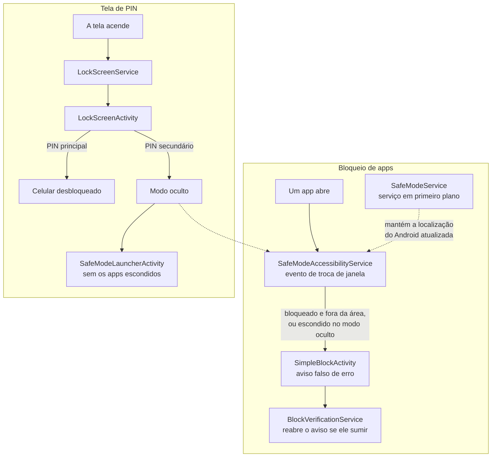

# SafeMode


*Prints de um emulador com Android 15: tela principal, área segura no mapa, aviso falso de erro e tela de PIN.*

O SafeMode é um app Android que bloqueia os apps escolhidos, como os de banco, quando o celular sai de uma área marcada no mapa. O bloqueio aparece como um aviso falso de erro, como se o app tivesse travado. O SafeMode também tem uma tela de PIN própria com dois PINs: o segundo desbloqueia o celular e esconde os apps escolhidos para esse caso.

## Por que existe

O SafeMode foi um trabalho da faculdade, feito em 2025, pensado para o roubo de celular em que o ladrão obriga a pessoa a desbloquear o aparelho e abre os apps de banco.

Longe da área segura, que pode ser a casa da pessoa, os apps de banco não abrem, e o ladrão não descobre que existe uma proteção: em vez de uma tela de "app bloqueado", ele vê um erro que parece do próprio Android. Se ele exigir o PIN, a pessoa pode digitar o PIN secundário, que desbloqueia o celular sem os apps de banco na tela inicial.

## O que dá para fazer

- Escolher os apps que ficam bloqueados. Com o bloqueio por localização ligado, eles só são bloqueados fora da área segura; com ele desligado, ficam bloqueados em qualquer lugar
- Marcar a área segura no mapa, com um ponto e um raio de 50 m a 2 km
- Ligar uma tela de PIN de 4 dígitos, que aparece sempre que a tela do celular acende
- Cadastrar um PIN secundário e escolher os apps que ele esconde
- Usar o launcher do SafeMode, em grade e com uma busca que ignora acentos
- Ver o histórico de bloqueios dos últimos 7 dias e quantos bloqueios houve no dia

## Stack

- Java 11 e Android SDK 35, com mínimo no Android 7.0 (API 24)
- AndroidX (AppCompat, ConstraintLayout, RecyclerView e CardView) e Material Components
- Google Maps SDK para marcar a área segura e Fused Location para achar a posição atual no mapa
- `LocationManager` do Android para acompanhar o GPS e a rede enquanto o bloqueio por localização está ligado
- `SharedPreferences` para as configurações, os PINs e o histórico de bloqueios, guardado em JSON
- Gradle com Kotlin DSL e catálogo de versões (`gradle/libs.versions.toml`)

## Como funciona



O `SafeModeAccessibilityService` recebe um evento a cada troca de janela e lê só o nome do pacote do app que abriu. Se o app está entre os bloqueados e o celular está fora da área, ou se o modo oculto está ligado e o app está entre os escondidos, o serviço abre a `SimpleBlockActivity` por cima dele, registra o bloqueio no histórico e inicia o `BlockVerificationService`, que nos segundos seguintes confere se o aviso continua na tela e o abre de novo se ele sumiu. A posição vem da última localização que o Android conhece, que o `SafeModeService` mantém atualizada enquanto o Safe Mode e o bloqueio por localização estão ligados. O serviço de acessibilidade guarda a posição que usou e só busca outra quando ela passa de 5 minutos, então a decisão pode demorar até 5 minutos para mudar quando o celular sai da área ou volta para ela.

A tela de PIN segue outro caminho. O `LockScreenService` fica esperando a tela acender e abre a `LockScreenActivity`, que ignora o botão de voltar e volta para a frente se alguém sair dela. O PIN principal fecha a tela de PIN. O secundário também fecha, mas liga o modo oculto, que o launcher e o serviço de acessibilidade passam a seguir.

| Classe | O que faz |
|---|---|
| `MainActivity` | Tela principal: liga o Safe Mode, o bloqueio por localização e a tela de PIN, e cadastra os dois PINs |
| `SafeModeAccessibilityService` | Recebe cada troca de janela e decide se o app que abriu deve ser bloqueado |
| `SimpleBlockActivity` | O aviso falso de erro, com os botões **Informações do app** e **Fechar app** |
| `BlockVerificationService` | Nos segundos depois de um bloqueio, abre o aviso de novo se ele sumiu da tela |
| `SafeModeService` | Serviço em primeiro plano que mantém a localização atualizada e mostra na notificação se o celular está dentro ou fora da área |
| `LocationManager` | Lê a localização do GPS e da rede e escolhe a mais precisa e recente |
| `LocationSetupActivity` | O mapa onde se marca o centro e o raio da área segura |
| `LockScreenService` e `LockScreenActivity` | Abrem a tela de PIN quando a tela acende e a mantêm na frente |
| `PinManager` | Guarda os dois PINs com hash e salt e diz qual deles foi digitado |
| `SafeModeLauncherActivity` | O launcher em grade, que esconde os apps escolhidos no modo oculto |
| `AppPreferences` e `BlockLogger` | Configurações e histórico de bloqueios, em `SharedPreferences` |
| `BootReceiver` | Religa os serviços depois de reiniciar o celular ou atualizar o app |

## Permissões

O SafeMode depende de permissões que a maioria dos apps não pede. Algumas só podem ser concedidas numa tela própria das Configurações do Android, e a tela **Configurações e permissões** do app leva até cada uma.

| Permissão | Para que o SafeMode usa | Onde |
|---|---|---|
| Serviço de acessibilidade | Saber qual app acabou de abrir. O serviço recebe um evento a cada troca de janela (`typeWindowStateChanged`) e lê só o nome do pacote | `SafeModeAccessibilityService` e `res/xml/accessibility_service_config.xml` |
| Exibir sobre outros apps (`SYSTEM_ALERT_WINDOW`) | Abrir o aviso falso de erro e a tela de PIN por cima do app que está na frente, com o SafeMode em segundo plano | `SimpleBlockActivity` e `LockScreenActivity` |
| Estatísticas de uso (`PACKAGE_USAGE_STATS`) | Ver qual app está na frente, na conferência que vem depois de cada bloqueio | `UsageStatsUtils` e `BlockVerificationService` |
| Localização (`ACCESS_FINE_LOCATION` e `ACCESS_COARSE_LOCATION`) | Saber se o celular está dentro da área segura e mostrar a posição atual no mapa | `LocationManager` e `LocationSetupActivity` |
| Serviço em primeiro plano do tipo localização (`FOREGROUND_SERVICE_LOCATION`) | Manter o serviço do Safe Mode ativo e a localização atualizada, com uma notificação que diz se o celular está dentro ou fora da área | `SafeModeService` |
| Localização em segundo plano (`ACCESS_BACKGROUND_LOCATION`) | Está no manifesto, mas o app ainda não pede essa permissão. A localização vem do serviço em primeiro plano da linha acima | Nenhum |
| Launcher padrão (filtro `HOME` no manifesto) | Esconder os apps no modo oculto, já que o launcher do sistema continuaria mostrando os ícones. Por isso a tela de PIN só liga com o SafeMode como launcher padrão | `SafeModeLauncherActivity`; a checagem fica em `MainActivity.enableLockScreen` |
| Ver todos os apps instalados (`QUERY_ALL_PACKAGES`) | Listar os apps para escolher quais bloquear e quais esconder, e montar o launcher | `AppSelectionActivity`, `HiddenAppsSelectionActivity` e `SafeModeLauncherActivity` |
| Serviço em primeiro plano de uso especial (`FOREGROUND_SERVICE_SPECIAL_USE`) | Manter ativo o serviço que abre a tela de PIN quando a tela acende | `LockScreenService` |
| Iniciar com o celular (`RECEIVE_BOOT_COMPLETED`) | Religar os serviços depois de reiniciar o celular ou atualizar o app | `BootReceiver` |

As notificações fixas dos serviços dependem de `POST_NOTIFICATIONS`, que também está no manifesto sem ser pedida. No Android 13 ou mais novo, elas só aparecem na gaveta de notificações se o usuário liberar as notificações do app. `INTERNET` e `ACCESS_NETWORK_STATE` vêm da biblioteca do Google Maps. O manifesto ainda declara `REQUEST_IGNORE_BATTERY_OPTIMIZATIONS`, `WAKE_LOCK` e `DISABLE_KEYGUARD`, que o código não usa, e repete `BIND_ACCESSIBILITY_SERVICE` como `uses-permission`, o que não tem efeito: essa permissão só vale no `android:permission` do serviço, onde já está.

## Decisões de projeto (e por quê)

### 1. O bloqueio parece um erro do Android

Uma tela de "app bloqueado" avisaria o ladrão de que existe uma proteção, e ele poderia obrigar a pessoa a desligá-la. Por isso a `SimpleBlockActivity` imita o aviso que o Android mostra quando um app trava: "O app X apresenta falhas contínuas", com os botões **Informações do app** e **Fechar app**. Antes do aviso, uma tela transparente segura os toques por 2 segundos.

### 2. Acessibilidade para saber qual app abriu

O serviço de acessibilidade recebe um evento no momento em que a janela muda, então o SafeMode fica sabendo na hora qual app abriu. A alternativa seria consultar as estatísticas de uso de tempos em tempos, e o app bloqueado ficaria visível até a consulta seguinte. As estatísticas de uso ficam só para a conferência que vem depois do bloqueio.

### 3. Um segundo PIN para quando a pessoa é obrigada a desbloquear

A tela de PIN aceita dois PINs, que precisam ser diferentes. O principal desbloqueia o celular. O secundário também desbloqueia, mas liga o modo oculto: o launcher do SafeMode deixa de mostrar os apps escolhidos e o próprio SafeMode. Com o Safe Mode ligado, quem chegar a um desses apps por outro caminho, como uma notificação, vê o aviso falso de erro. O modo oculto acaba na próxima vez que alguém digitar o PIN principal.

### 4. Um launcher próprio

Um app comum não consegue esconder ícones no launcher de outro app. Para o modo oculto funcionar, o SafeMode traz o próprio launcher, e a tela de PIN só liga quando ele é o launcher padrão.

### 5. Na dúvida, bloqueia

Se não há localização ou se a área segura ainda não foi marcada, o SafeMode bloqueia os apps escolhidos. Num app contra roubo, liberar o app do banco por falta de sinal de GPS seria pior do que bloqueá-lo em casa por engano.

### 6. Apps essenciais ficam de fora

O telefone, o discador, a tela de chamada, as chamadas de emergência, a interface do sistema, os launchers, o instalador de apps, o Google Play Services e as Configurações nunca são bloqueados. Assim o celular continua fazendo ligações, e a pessoa não perde o acesso às Configurações.

### 7. PINs com hash e salt

Os PINs não ficam em texto puro. Para cada PIN, o `PinManager` gera um salt aleatório de 16 bytes com `SecureRandom` e guarda o salt e o hash SHA-256 do salt seguido do PIN.

## Como rodar

Precisa do Android Studio, ou do JDK 17 ou mais novo com o Android SDK 35, e de um celular ou emulador com Android 7.0 ou mais novo e Google Play Services.

1. Crie o arquivo `secrets.properties` na raiz do projeto, com a chave do Google Maps:

   ```properties
   MAPS_API_KEY=sua_chave
   ```

   A chave sai do Google Cloud Console, com o Maps SDK for Android ativado. O arquivo está no `.gitignore`. Sem a chave, o app compila e funciona, mas o mapa da área segura fica cinza, sem as ruas.

2. Com o celular ou o emulador conectado, compile e instale o app:

   ```bash
   ./gradlew installDebug
   ```

   No Windows, use `gradlew.bat installDebug`. No Android Studio, basta abrir a pasta e rodar (Shift+F10).

3. No app, toque em **Configurações e permissões** e depois em **Configurar permissões**. Cada toque abre o pedido do Android para a próxima permissão que falta. Repita até as quatro ficarem verdes: localização, sobreposição, estatísticas de uso e acessibilidade.

4. Escolha os apps em **Selecionar apps para bloquear**, marque a área em **Configurar área permitida** e salve com **Salvar localização**. Depois ligue o **Safe Mode** e o **Bloqueio por Localização**.

Para usar a tela de PIN, toque em **Definir como launcher padrão**, em **Configurações e permissões**, e escolha o Safe Mode. Depois salve o PIN principal e o secundário na tela principal do app, escolha em **Selecionar apps para ocultar** os apps que o PIN secundário esconde e ligue **Ativar Ocultação com PIN**.

No emulador, dá para simular a saída da área mudando a localização com `adb emu geo fix <longitude> <latitude>`. O bloqueio pode levar até 5 minutos para mudar, pelo motivo explicado em [Como funciona](#como-funciona).

## Limitações

- As Configurações do Android nunca são bloqueadas. Com o celular desbloqueado, dá para desligar o serviço de acessibilidade ou desinstalar o SafeMode por lá.
- A tela de PIN é uma tela do app por cima do sistema e não substitui o bloqueio do Android. Reiniciar o celular no modo de segurança do Android desliga os apps que não vieram com o celular, inclusive o SafeMode.
- O PIN tem só 4 dígitos, que ficam visíveis enquanto a pessoa digita, e a tela de PIN não limita as tentativas.

## Próximos passos

- Fazer o serviço de acessibilidade usar a posição atual. Hoje ele reaproveita a última posição que leu por até 5 minutos: no emulador, o Chrome abriu normalmente fora da área porque um teste dentro dela tinha sido feito 36 segundos antes, e continuou bloqueado depois de a posição voltar para a área
- Tirar a espera por localização da thread principal. Sem uma localização recente, o serviço de acessibilidade espera até 8 segundos com `Thread.sleep`, mas a resposta do GPS chega por essa mesma thread e só é processada depois da espera. Assim, a decisão usa a localização antiga ou, se não houver nenhuma, trata o celular como fora da área. Durante a espera, o app bloqueado fica livre: no emulador, o Chrome pôde ser usado por 3 segundos antes de o SafeMode cobri-lo
- Corrigir o `isBetterLocation` do `LocationManager`, que descarta uma posição nova do mesmo provedor quando ela não é mais precisa nem 2 minutos mais nova. Como o pedido de posições exige que o celular ande 5 metros, a notificação pode ficar com o status antigo: no emulador, ela continuou em "Área permitida" por mais de 4 minutos com o celular parado fora da área
- Corrigir a conferência do `BlockVerificationService`: do jeito que a condição está escrita, ela reabre o aviso sempre que ele não está na tela, e a consulta às estatísticas de uso não muda o resultado
- Limitar as tentativas de PIN, com uma espera que cresce a cada erro
- Esconder os dígitos na tela de PIN. Os campos são `numberPassword`, mas os números continuam visíveis depois de digitados
- Pedir as permissões de notificação e de localização em segundo plano, que estão no manifesto mas não são pedidas
- Limpar a configuração: tirar do manifesto as permissões que o código não usa e os serviços `LocationService` e `BlockOverlayService`, que nada inicia, e desligar no `accessibility_service_config.xml` o `canRetrieveWindowContent`, que o SafeMode não usa
- Separar as 27 classes em pacotes e dividir a `MainActivity`, que tem 681 linhas
- Escrever testes unitários para o `PinManager` e para a conta da distância até a área

## Licença

[MIT](LICENSE)
